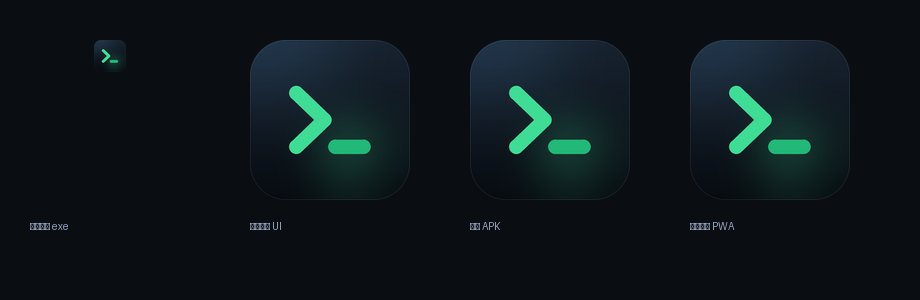
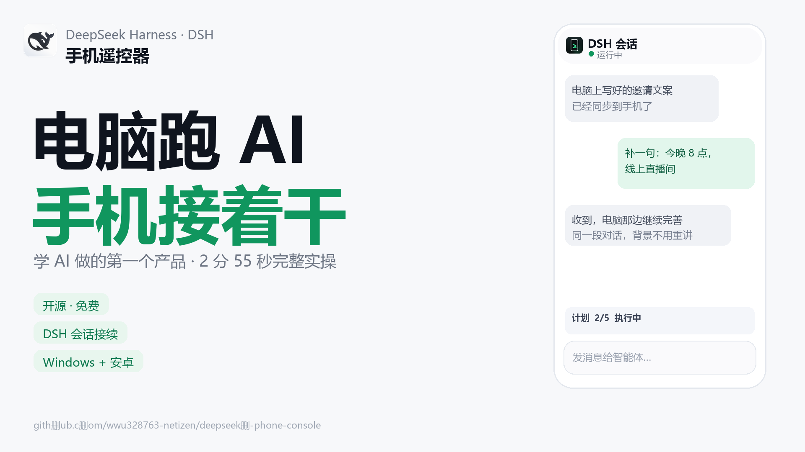
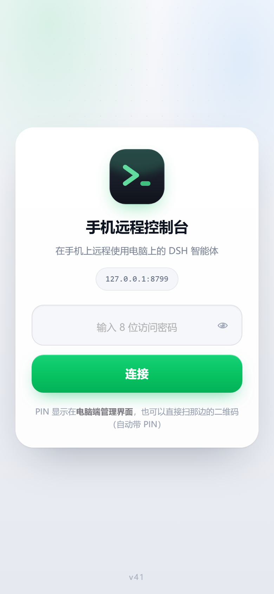
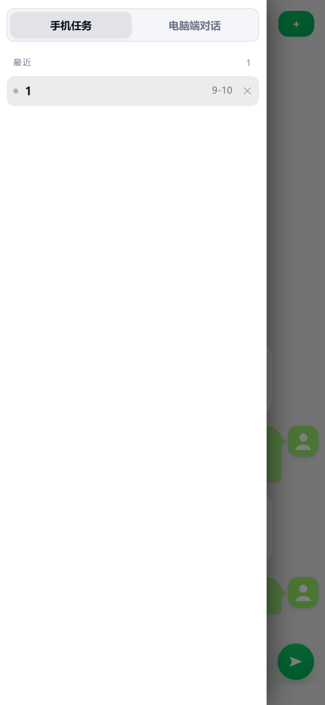
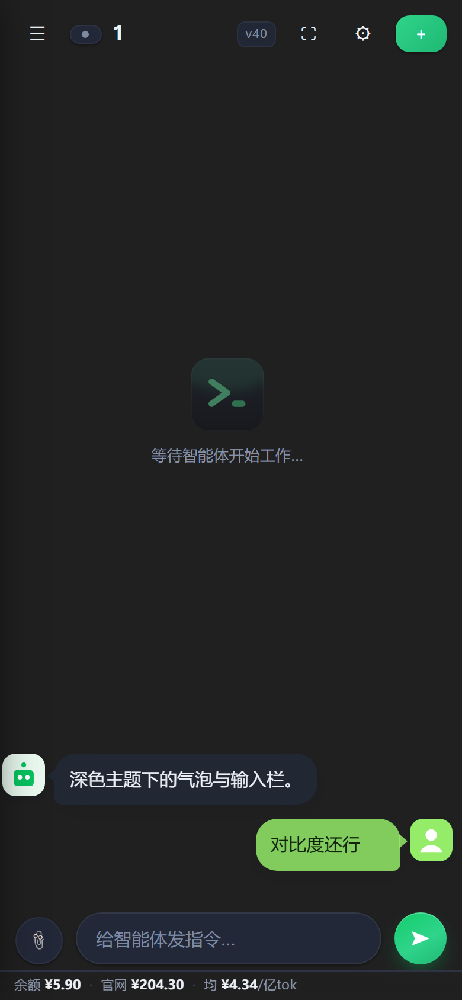
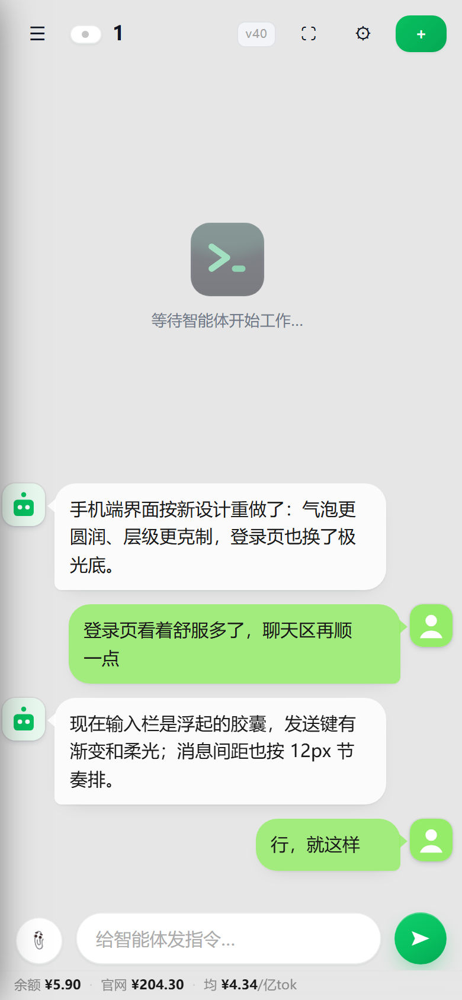
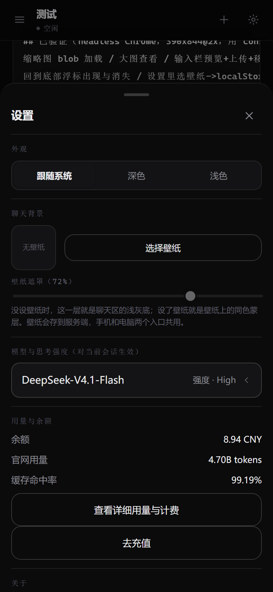
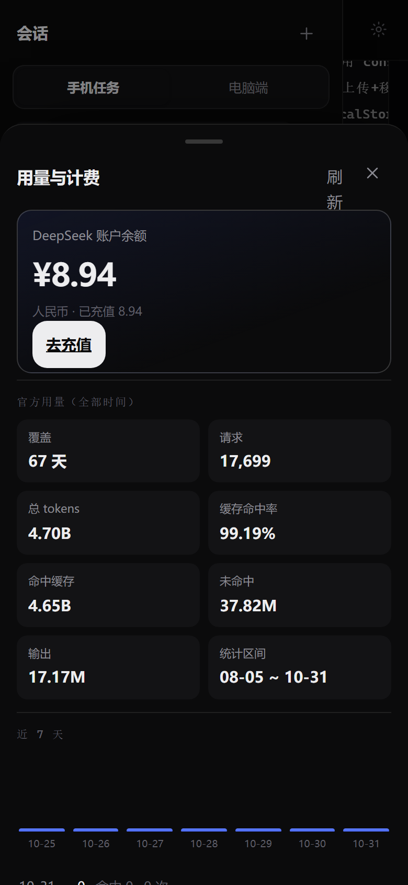
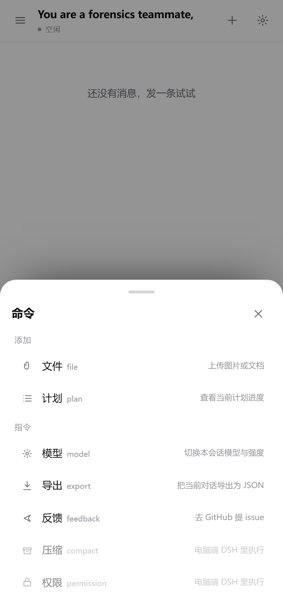
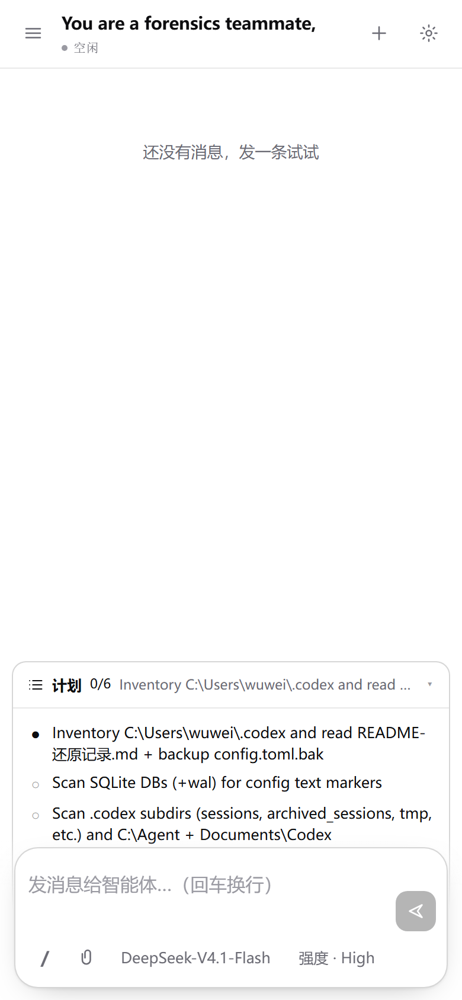

<div align="center">



# DeepSeek Phone Console

**用手机远程操控电脑上的 DeepSeek Harness（DSH）智能体。**
桌面面板 + 手机网页 + Android App，三端一体。


</div>

---

## 🎬 演示视频（2 分 20 秒）

[](https://github.com/wwu328763-netizen/deepseek-phone-console/releases/download/v3.2.2/phone-console-intro-1080p.mp4)

手机与电脑双向接续的完整实操：连接 → 电脑端补一句 → 手机接着看 → 手机排队/改稿 → 发图片 → 用量页。

- 视频（1080p / H.264）：[phone-console-intro-1080p.mp4](https://github.com/wwu328763-netizen/deepseek-phone-console/releases/download/v3.2.2/phone-console-intro-1080p.mp4)
- 字幕：[phone-console-intro.srt](https://github.com/wwu328763-netizen/deepseek-phone-console/releases/download/v3.2.2/phone-console-intro.srt)
- 封面：[phone-console-intro-cover.png](https://github.com/wwu328763-netizen/deepseek-phone-console/releases/download/v3.2.2/phone-console-intro-cover.png)

## ⚠️ 先确认你能用（重要）

这不是一个独立产品，而是 **DSH 的遥控器**。开始之前请确认：

| 条件 | 说明 |
| --- | --- |
| **Windows 10/11** | 面板用 WebView2，脚本用 PowerShell；**Linux / macOS 不可用** |
| **已安装并能正常使用 DSH** | 没有 DSH 时本项目只能起个空壳。DSH 需在本机运行，默认端口 `8314`（也兼容 `3080` 等） |
| **WebView2 Runtime** | Win11 自带；Win10 若面板白屏，装 [WebView2 Runtime](https://developer.microsoft.com/microsoft-edge/webview2/) |
| **Python 3.11+** | `pip install -r requirements.txt` |
| **手机** | Android 7+ 装 APK，或直接用浏览器打开 |

> 只想在内网用：不需要公网，也不需要装 APK —— 手机浏览器打开 `http://<电脑内网IP>:8787` 即可。

## 它能做什么

| 分类 | 能力 |
| --- | --- |
| 会话 | 电脑端会话 / 手机任务双栏，归档、重命名、删除、绿点实时运行态 |
| 消息 | 文字、图片（缩略图/大图）、文档（类型徽标 + 下载） |
| 发送控制 | 忙时单按钮：空=停止、有文字=排队、长按=立即插入；队列可取消、可插队、可**重新编辑** |
| 计划 / 目标 | 输入框上方镜像 DSH 的 todos 与 goal；斜杠命令菜单可查看/设置目标 |
| 模型 | 输入栏 & 设置里的弹窗选择模型与思考强度，点一下即生效 |
| 附件 | 上传落到**当前会话工作区** `.uploads/`，电脑端同步可见 |
| 用量 | 余额、官方 token、缓存命中率、请求数、按天消耗金额、近 7 天明细 |
| 体验 | 深浅色、聊天壁纸、PWA、断线重连、上传进度、命令菜单 |

## 界面预览

### 电脑端面板

> 截图待补（Codex 单独截图后补入）。

### 手机端

<table align="center" width="100%">
  <tr>
    <td align="center"><br /><sub>登录 · PIN</sub></td>
    <td align="center"><br /><sub>会话侧栏 · 归档 / 用量入口</sub></td>
    <td align="center"><br /><sub>深色聊天</sub></td>
    <td align="center"><br /><sub>浅色聊天</sub></td>
  </tr>
  <tr>
    <td align="center"><br /><sub>设置</sub></td>
    <td align="center"><br /><sub>用量与计费</sub></td>
    <td align="center"><br /><sub>斜杠命令菜单</sub></td>
    <td align="center"><br /><sub>输入框上方的计划条</sub></td>
  </tr>
</table>

## 5 分钟上手

```powershell
# 1. 依赖
pip install -r requirements.txt

# 2. 确认 DSH 已在运行（电脑上能正常对话）
#    不知道端口就用默认，启动时会自动探测

# 3. 启动控制台（自动起服务 + 隧道 + 打印 PIN/地址）
powershell -ExecutionPolicy Bypass -File run.ps1
```

启动后终端会打印：

```
本机访问:   http://127.0.0.1:8787
局域网访问: http://192.168.x.x:8787
PIN:      12345678
隧道地址:  https://xxxx.trycloudflare.com      ← 需要公网时才用
```

手机端三选一：

1. **局域网（推荐、最稳）**：同一 Wi-Fi 下打开 `http://<内网IP>:8787`，输入 PIN
2. **公网隧道**：打开隧道地址（含 `?pin=` 可免输入）
3. **APK**：`dist/手机远程控制台-v3.2.0.apk`，扫码/粘贴地址即可；也可"添加到主屏幕"当 PWA

## 三种访问方式怎么选

| 方式 | 稳定性 | 地址 | 适用 |
| --- | --- | --- | --- |
| 局域网直连 | ★★★ | 固定（内网 IP） | 在家/公司同一网络，**首选** |
| Cloudflare Quick Tunnel | ★★ | **每次重启都会变** | 在外面、4G 网络 |
| APK 壳 | ★★★ | 跟随所填地址 | 想要图标/全屏/免浏览器 |

> ⚠️ 隧道是临时的：电脑重启、`cloudflared` 重连后域名会换。手机存着旧地址会报 **Cloudflare Error 1033** —— 重新扫面板二维码即可（不是 App 坏了）。
> ⚠️ Cloudflare 在国内部分网络不稳定；连不上时改用局域网。

## APK 说明

- 从 Release 下载的 APK **用项目作者的签名**；你自己构建的 APK 签名不同，**不能覆盖安装**官方包（需先卸载）
- APK 本质是 WebView 壳：**界面更新不需要重装 App**（服务端页面变了刷新即可），只有原生部分变更才需要装新版
- 版本检查：`/app-version.json`（App 内"检查更新"读取）
- 安装被 Play 保护机制拦截：侧载自签名 APK 的正常现象，点「仍要安装」或用 `adb install -r -d`

## 目录结构

```
phone-console/
├─ server.py              # HTTP 服务 + 全部 /api 接口 + 静态站点
├─ console_core.py        # 进程编排：服务/隧道/PIN/地址
├─ dsh_client.py          # DSH JSON-RPC 客户端
├─ sessions.py            # 会话数据与官网用量解析
├─ panel/                 # pywebview 桌面面板（扫码/状态/日志/用量）
├─ webapp/                # 手机端前端源码（Preact + TypeScript）
├─ web/                   # 前端构建产物 + APK + PWA 清单 + SW
├─ android-app/           # Android WebView 壳（Gradle/Kotlin）
├─ dist/                  # 发布用 APK
├─ tools/                 # 截图 / 冒烟脚本 / cloudflared 下载
└─ docs/                  # 接口 / 架构 / 构建 / 安全文档
```

## 接口

完整清单见 [`docs/API.md`](docs/API.md)。四层：

1. **HTTP API**（`:8787`，`X-Console-Pin` 鉴权）：会话/发送/上传/停止/模型/用量/归档/文件
2. **桌面面板桥**（`window.pywebview.api.*`）
3. **Android 壳桥**（`window.PhoneConsole.*`）
4. **DSH JSON-RPC**（`session/*`）

## 构建（可选）

见 [`docs/BUILD.md`](docs/BUILD.md)。

```powershell
cd webapp; npm install; npm run build              # 前端（产物到 web/app/）
powershell -File panel/build.ps1                   # 桌面面板（需 pywebview + pyinstaller）
powershell -File android-app/scripts/build-and-publish.ps1   # APK（需 JDK17 + Android SDK）
```

构建脚本会按顺序找：`JAVA_HOME` / `ANDROID_HOME` → 仓库旁的 `.jdk17`、`.android-sdk` → `%LOCALAPPDATA%\Android\Sdk`。
签名用环境变量：`CONSOLE_KEYSTORE`、`CONSOLE_STORE_PASSWORD`、`CONSOLE_KEY_ALIAS`、`CONSOLE_KEY_PASSWORD`；不提供则产出未签名 APK。

## 常见问题

<details>
<summary><b>面板白屏 / 打不开</b></summary>

装 WebView2 Runtime；或先确认 `python panel/host.py` 能启动。
</details>

<details>
<summary><b>提示「请先启动 DSH 控制台」</b></summary>

DSH 没运行或端口不对。先确保 DSH 桌面版/网页版能用，再用 `--dsh-url http://127.0.0.1:<端口>` 指定。
</details>

<details>
<summary><b>手机打开是 Cloudflare Error 1033</b></summary>

隧道地址失效（重启过）。重新扫面板二维码，或改用局域网地址。
</details>

<details>
<summary><b>杀毒软件拦截 ConsolePanel.exe</b></summary>

PyInstaller 打包的常见误报；可只跑 `run.ps1`（无面板），或把目录加入信任。
</details>

<details>
<summary><b>端口 8787 被占用</b></summary>

`run.ps1 -Port 8790`，或面板里改端口后重启。
</details>

<details>
<summary><b>手机能连但没数据</b></summary>

PIN 不对会 401；另外检查 DSH 是否登录（凭据过期需重新登录 DSH）。
</details>

## 已知限制

- **计划模式**只能电脑端开关（DSH 客户端命令 `/plan`，未暴露 RPC）；手机端只能看计划进度、可以设目标
- `压缩 / 权限` 同理，仅电脑端 DSH 可执行
- 单机单用户设计：没有多账号、没有权限分级
- 免费隧道地址不固定；Windows only

## 安全须知

- 所有 `/api/*` 需要 PIN；PIN、会话、附件都在本机 `console_data/`，不随仓库分发
- 默认监听 `0.0.0.0`（局域网可访问）。**只在本机用请加 `--host 127.0.0.1`**；不用时 `stop-all.bat` 关掉隧道
- 隧道链接里带 `?pin=`，截图分享前注意遮 PIN
- `--workdir-root` 决定手机能读写的根目录，**不要指向整个用户目录**
- 签名密钥不要提交（仓库已忽略 `*.keystore`）

## 制作

**wwu328763-netizen（人类）** × **DeepSeek Harness（AI）**

- 人类：需求、交互设计、真机验收、问题反馈
- AI：架构、编码、调试、构建发布、文档

## ☕ 如果它帮到了你

这个项目是一个人 + 一个 AI 在工作之余维护的：开源、免费、没有会员，也不放广告。

如果它帮你省下了来回跑电脑的时间，或者让你在通勤路上也把活干完了，可以随缘请作者喝杯咖啡。
金额随意，心意到就好；**不打赏也完全不影响使用**。

所有支持会用在：真机测试机、隧道与服务器开销，以及把「已知限制」里的那些慢慢做完。

<table>
<tr>
<td align=center><b>支付宝</b><br/></td>
<td align=center><b>微信支付</b><br/></td>
</tr>
</table>

## License

[MIT](LICENSE) © 2026 wuwei (wwu328763-netizen) & DeepSeek Harness
