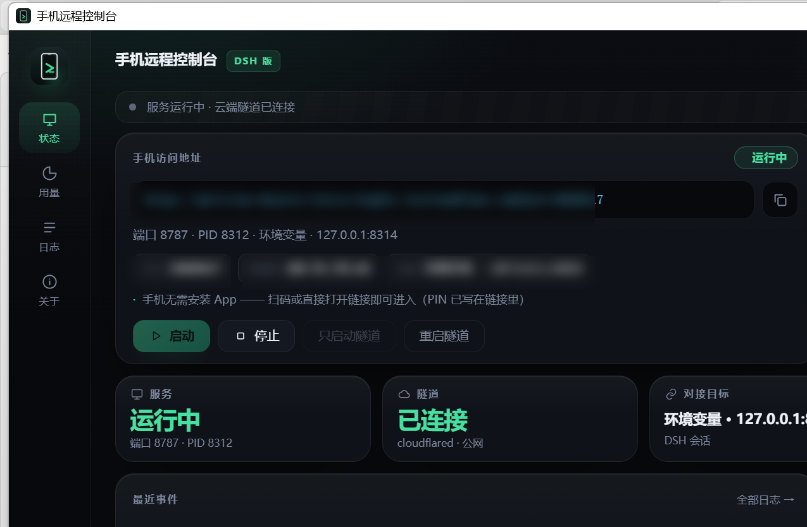
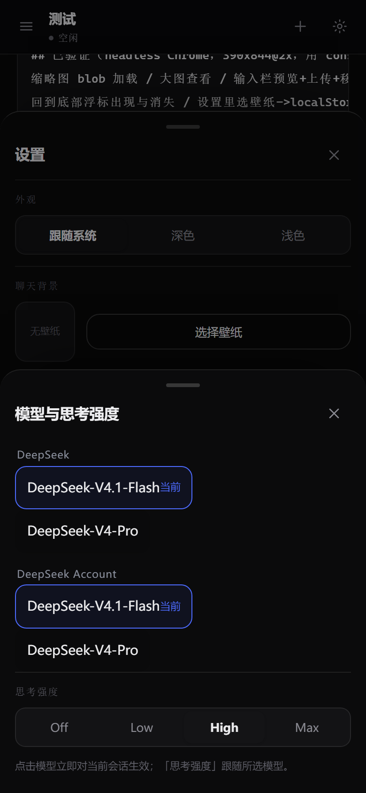

<div align="center">


# 手机远程控制台 · Phone Console

**用手机远程操控电脑上的 DeepSeek Harness（DSH）智能体。**

桌面面板 + 手机网页 + Android App，三端一体。


</div>

---

## 这是什么

你在电脑上跑着 DSH（DeepSeek Harness）智能体，但人已经离开电脑 —— 想让它继续干活、
想看它跑到哪、想补一句话，就得回到电脑前。

**手机远程控制台**把电脑上的 DSH 会话"镜像"到手机上：

- 电脑端：一个 WebView2 面板，负责扫码、起服务、打隧道、看状态
- 手机端：浏览器打开网页，或用 Android App（PWA 亦可）
- 中间：本机 HTTP 服务 + Cloudflare 隧道，手机不在同一 Wi-Fi 也能用

手机上和电脑上是**同一段对话**：发消息、发图片、发文件、排队、插队、停止、切模型、看用量。

## 功能一览

| 分类 | 能力 |
| --- | --- |
| 会话 | 电脑端会话 / 手机任务双栏，归档、重命名、删除、绿点实时运行态 |
| 消息 | 文字、多行、图片（缩略图/大图）、文档（类型徽标 + 下载） |
| 发送控制 | 空闲直接发；忙时单按钮（空=停止、有文字=排队、长按=立即插入）；队列可取消、可**插队** |
| 模型 | 输入栏旁 & 设置里的弹窗选择模型与思考强度，点一下即生效 |
| 附件 | 手机拍照/选文件上传，落**当前会话的工作区** `.uploads/`，电脑端同步可见 |
| 用量 | 余额（金额）、官方 token、缓存命中率、请求数、近 7 天柱状与明细 |
| 体验 | 深浅色、聊天壁纸、PWA 安装、断网重连、上传进度 |

## 界面预览

### 电脑端面板

<p align="center">
  
</p>

<p align="center"><sub>电脑端面板：服务与隧道的运行状态、手机访问地址（含 PIN）、最近事件</sub></p>

### 手机端

<table align="center" width="100%">
  <tr>
    <td align="center"><br /><sub>登录 · PIN</sub></td>
    <td align="center"><br /><sub>会话侧栏 · 归档 / 用量入口</sub></td>
    <td align="center"><br /><sub>浅色聊天</sub></td>
    <td align="center"><br /><sub>深色聊天</sub></td>
  </tr>
  <tr>
    <td align="center"><br /><sub>设置 · 模型/强度弹窗入口</sub></td>
    <td align="center"><br /><sub>模型与思考强度</sub></td>
    <td align="center"><br /><sub>余额 / 官方用量 / 近 7 天</sub></td>
    <td align="center"><br /><sub>应用图标</sub></td>
  </tr>
</table>

## 架构

```
┌────────────────────────────┐        ┌──────────────────────────────┐
│   手机（Android / 浏览器）  │        │  电脑（Windows）              │
│                            │        │                              │
│  webapp/ (Preact + TS)     │  HTTPS │  server.py  :8787            │
│   ├─ 聊天 / 侧栏 / 设置      │◄──────►│   ├─ /api/*  HTTP 接口        │
│   ├─ 图片缩略图 / 文件卡     │ 隧道    │   ├─ 静态页面 web/app/        │
│   └─ 排队 / 插队 / 模型弹窗  │        │   └─ 附件落盘 .uploads/       │
│                            │        │                              │
│  android-app/ (WebView 壳)  │        │  panel/ (pywebview 面板)      │
└────────────────────────────┘        │   └─ 扫码 / 启停 / 日志        │
                                      │                              │
                                      │  DSH 127.0.0.1:8314          │
                                      │   └─ session/prompt 等 RPC    │
                                      └──────────────────────────────┘
```

- **不需要公网服务器**：隧道用 Cloudflare Quick Tunnel（临时域名），或局域网直连
- **不存云端**：所有会话/附件/配置都在本机 `console_data/`
- **同一 PIN 保护**：所有 `/api/*` 都要 `X-Console-Pin`

## 快速开始

### 1. 电脑端

```powershell
# 依赖（Python 3.11+）
pip install -r requirements.txt

# 启动（自动拉起 DSH 检测、本机服务 8787、Cloudflare 隧道）
powershell -ExecutionPolicy Bypass -File run.ps1
```

或双击 `start-all.bat`。启动后终端会打印：

```
本机访问:   http://127.0.0.1:8787
PIN:      12345678
隧道地址:  https://xxxx.trycloudflare.com
```

面板版（WebView2 窗口 + 二维码）：`panel/build.ps1` 构建后运行 `ConsolePanel.exe`。

### 2. 手机端

- **APK**（推荐）：下载 [`dist/手机远程控制台-v3.1.9.apk`](dist/手机远程控制台-v3.1.9.apk)，
  安装后扫码或粘贴隧道地址 + PIN
- **浏览器**：直接打开隧道地址，输入 PIN，可"添加到主屏幕"当 PWA 用

## 目录结构

```
phone-console/
├─ server.py              # HTTP 服务 + 全部 /api 接口 + 静态站点
├─ console_core.py        # 进程编排：服务/隧道/PIN/地址
├─ dsh_client.py          # DSH JSON-RPC 客户端
├─ sessions.py            # 会话数据与官网用量解析
├─ panel/                 # pywebview 桌面面板（扫码/状态/日志）
├─ webapp/                # 手机端前端源码（Preact + TypeScript）
├─ web/                   # 前端构建产物 + APK + PWA 清单 + SW
├─ android-app/           # Android WebView 壳（Gradle/Kotlin）
├─ dist/                  # 发布用 APK
├─ tests/                 # 冒烟测试脚本
└─ docs/                  # 接口 / 架构 / 构建 / 安全文档
```

## 接口

所有接口均在 [`docs/API.md`](docs/API.md)，摘要：

| 方法 | 路径 | 说明 |
| --- | --- | --- |
| POST | `/api/login` | 校验 PIN |
| GET | `/api/info` | 服务信息、隧道地址、会话列表 |
| GET | `/api/threads` `/{id}` | 手机任务列表 / 详情 |
| POST | `/api/threads/{id}/send` | 发消息（忙时 409） |
| POST | `/api/threads/{id}/upload` | 上传附件（落会话工作区） |
| POST | `/api/threads/{id}/stop` | 停止当前回答 |
| GET | `/api/sessions` `/{id}` | 电脑端会话列表 / 详情 |
| POST | `/api/sessions/{id}/send` `continue` | 继续电脑端会话 |
| GET | `/api/usage` `/api/balance` | 用量与余额 |
| GET | `/api/raw?path=` | 取原文件（图片/文档） |
| GET/POST | `/api/archived` `/api/archive` | 归档 / 取消归档 |

## 构建

见 [`docs/BUILD.md`](docs/BUILD.md)。三块产物：

```powershell
# 前端（手机端 UI）
powershell -File webapp/build.ps1

# 桌面面板
powershell -File panel/build.ps1

# Android APK（需要 JDK 17 + Android SDK，签名密钥自备）
powershell -File android-app/scripts/build-and-publish.ps1
```

## 更新日志

### v3.1.9（当前）

- 去掉 edge-to-edge：手机页面上下不再各留一条空白
- 附件链路修复：上传 502（`session_workdir` 静态方法错位）
- 图片/文档消息归一化：手机端干净气泡 + 缩略图，电脑端 markdown 内联图 / 可点链接
- 用量与计费弹窗：余额 + 官方 token/命中率/请求数 + 近 7 天
- 设置里的模型/强度改为弹窗；排队消息支持 ↑ 插队

<details>
<summary>更早版本</summary>

- v3.1.6：任务目录与 DSH 会话 cwd 对齐、侧边栏归档、绿点校正
- v3.1.3：排队消息插队按钮
- v3.1.1：繁忙时只留一个按钮（DSH 风格）
- v3.0.7：文件类型徽标 + 图片缩略图
- v3.0.0：v2 前端（Preact + TS）重构
</details>

## 制作团队

本项目由 **wwu328763-netizen** 与 **DeepSeek Harness（AI）** 共同完成：

- **wwu328763-netizen** —— 需求、产品设计、真机测试与反馈闭环
- **DeepSeek Harness（AI）** —— 架构设计、代码实现、调试与文档

> 一个长跑式的人机协作样本：从"手机控制台"这个想法，到 30+ 个迭代版本、
> 真机截图驱动的像素级打磨。

## 安全说明

- 所有接口需要 PIN；PIN 存在 `console_data/pin.txt`，**不要提交**
- 隧道是临时公网地址，用完即关；不需要时停掉服务即可
- **不要把 `console.keystore` 提交到仓库**（构建时用你自己的签名）
- 本仓库已剔除运行数据、上传附件、密钥与二进制

## 许可

[MIT](LICENSE) © 2026 wwu328763-netizen & DeepSeek Harness
